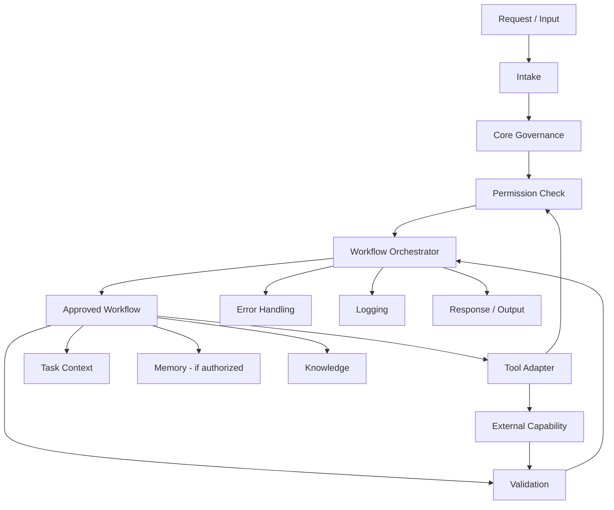

# Component Model and Interface Boundaries

**Status:** Proposed conceptual model — pending owner review.  
**Implementation:** Documentation only.

This document expands the component relationships in [Architecture](ARCHITECTURE.md). It does not approve a technology stack or authorize implementation.

## 1. Logical relationship map

The diagram shows conceptual relationships only. It is not an implementation diagram. Permission checks apply before protected actions, including actions performed through adapters.

## 2. Component contracts

| Component | Receives | Returns | Failure behavior |
| --- | --- | --- | --- |
| Intake | User request and channel metadata | Normalized task envelope or clarification request | Reject malformed input; ask for missing required details |
| Core governance | Task envelope and applicable rules | Applicable constraints and policy outcome | Stop or escalate unresolved policy conflict |
| Permission check | Requested action, actor, resource, scope | Allow, deny, or require approval with bounded scope | Deny by default if unavailable or indeterminate |
| Workflow registry | Workflow identifier or selection criteria | Versioned workflow metadata and status | Do not select unknown, retired, or unapproved workflow |
| Orchestrator | Authorized task and workflow definition | Execution state and step results | Stop safely; preserve state and report failure |
| Workflow module | Declared inputs and approved capabilities | Declared outputs and evidence references | Return typed failure; do not claim success |
| Tool adapter | Scoped request and authorization context | Normalized external result | Enforce timeout, scope, and error mapping |
| Task context | Task-scoped data operations | Temporary task data | Do not silently promote temporary data to durable memory |
| Memory | Approved read/write request and retention metadata | Permitted durable record or result | Deny unapproved storage or access |
| Knowledge | Query and source constraints | Referenced material with provenance | Report missing or uncertain sources |
| Validation | Expected criteria and candidate result | Pass, fail, or inconclusive with evidence | Fail closed for criteria that are mandatory |
| Logging | Approved event metadata | Event record or logging failure signal | Do not expose secrets; logging failure policy must be defined per event class |
| Error handling | Typed failure and execution context | Stop, bounded retry, recovery, or escalation decision | Escalate if safe recovery is undefined |

## 3. Cross-component rules

1. Components communicate through versioned contracts rather than shared internal state.
2. Every protected action carries a scoped authorization decision.
3. Authorization is checked at the protected action boundary, not inferred from workflow selection or an earlier orchestration check.
4. A workflow cannot grant itself permission or elevate its own privilege.
5. External content and tool output cannot override core instructions.
6. Durable memory writes require an explicit storage policy and authorization.
7. Validation criteria are defined independently of the component being validated.
8. Errors must retain their original category and must not be reported as successful completion.
9. Logging must use identifiers and summaries where possible rather than copying sensitive payloads.
10. Future detailed interface design names the PEP owner for every protected side-effect boundary and requires exact-context comparison against the applicable Permit immediately before the side effect.
11. A downstream independent boundary enforces its own applicable controls. An upstream Permit or PEP check does not replace downstream enforcement; this is a design requirement, not a selected topology or implementation.

## 4. Interface versioning

When interfaces are eventually implemented, each should have:
- a stable identifier;
- a semantic version or equivalent compatibility marker;
- a documented schema;
- compatibility and deprecation rules;
- tests for valid, invalid, and boundary inputs.

Breaking changes require impact review and a documented migration plan.

## 5. Open design questions

These remain unresolved until the agent's purpose and execution context are known:

- Which components must be separate processes versus libraries or modules?
- Is orchestration synchronous, asynchronous, event-driven, or hybrid?
- Which state requires durable storage?
- What identity model and permission granularity are appropriate?
- Which events require immutable audit records?
- What availability, latency, cost, and recovery objectives apply?

Do not decide these based on convenience alone. Revisit them after the purpose and operating constraints are defined.
