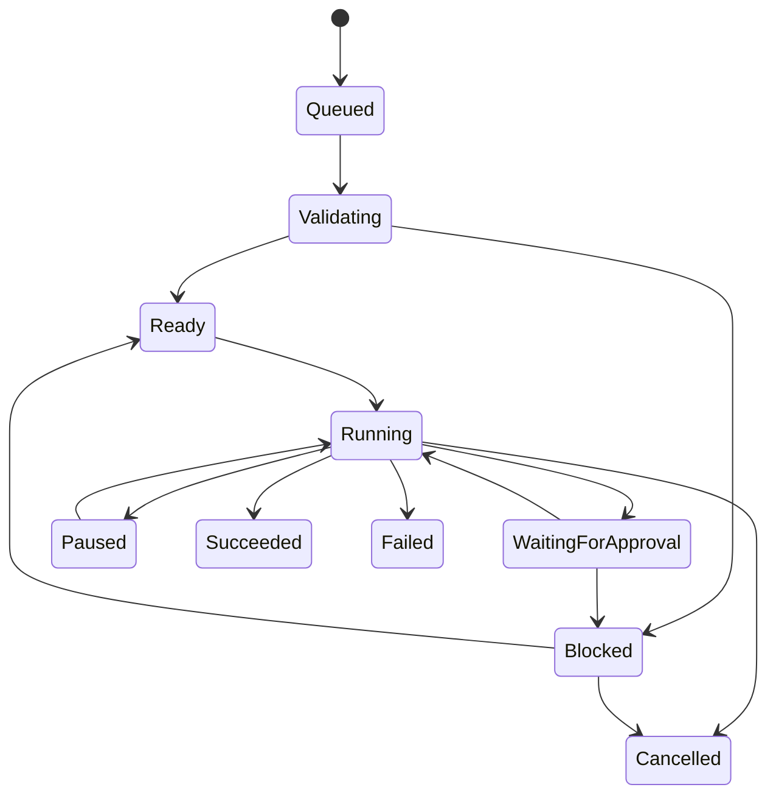

# Workflow Management System (WMS)

**Status:** Proposed architecture — pending owner review.  
**Implementation status:** Documentation only. No workflow engine, registry service, or execution runtime exists.

## 1. Purpose

The Workflow Management System (WMS) governs how workflow definitions are catalogued, selected, checked, coordinated, monitored, and evaluated.

It provides a consistent lifecycle for future workflows while keeping each workflow modular and independently maintainable.

The WMS does not define the agent's operational purpose and does not itself perform domain-specific work.

## 2. Scope and exclusions

### In scope
- Workflow definition registration and version metadata.
- Workflow lifecycle and approval status.
- Workflow discovery and selection.
- Input and precondition validation.
- Execution coordination and state tracking.
- Permission checks and approval pauses.
- Output validation and completion reporting.
- Failure handling, bounded retry, cancellation, and recovery records.
- Workflow history and traceability requirements.

### Out of scope
- Defining the agent's global identity or core policy.
- Granting permissions or overriding the permission system.
- Implementing individual domain workflows.
- Implementing external tools or integrations.
- Owning long-term user memory or the knowledge base.
- Choosing a runtime, orchestration framework, database, or deployment topology.

## 3. Architectural components

| Component | Responsibility | Must not do |
| --- | --- | --- |
| Workflow Registry | Stores workflow identifiers, versions, metadata, lifecycle status, and references to specifications | Execute workflows or grant permissions |
| Workflow Selector | Finds a suitable workflow from the request and declared selection criteria | Invent a workflow or select an ineligible version |
| Workflow Validator | Checks declared inputs, schemas, preconditions, and dependencies | Silently fill material missing inputs or waive failed preconditions |
| Workflow Orchestrator | Coordinates steps, branches, transitions, waits, and handoffs | Rewrite workflow definitions or bypass policy |
| Permission Gate | Requests authorization for each protected action at the point of use | Create or expand permissions |
| Execution State Manager | Tracks each run, current step, status, timestamps, and recovery checkpoint references | Treat temporary run state as durable user memory |
| Result Validator | Evaluates outputs against declared acceptance criteria | Change criteria after seeing results to force a pass |

These are logical responsibilities, not a requirement for separate processes.

## 4. Workflow definition and registry

Every workflow must have:
- unique, stable workflow ID;
- human-readable name and purpose;
- immutable version identifier;
- specification location and integrity reference;
- owner or responsible maintainer;
- workflow definition status;
- supported trigger and selection criteria;
- declared input and output contracts;
- preconditions and dependencies;
- required capabilities and permission scopes;
- prohibited actions, restrictions, and scope exclusions;
- side-effect and approval declarations;
- execution and failure-handling rules;
- validation criteria and test references;
- change history and approval evidence.

A registry entry is metadata, not proof that a workflow is executable or safe. A workflow definition must not become selectable for execution merely because it has been registered.

### Version pinning

Each execution must reference one exact workflow ID and version. A running execution must not silently switch to a newer definition. Updates create a new version and follow review and approval requirements. Retired versions must not be selected for new runs, although historical records must remain interpretable.

## 5. Workflow definition lifecycle

Definition lifecycle and execution lifecycle are separate.

| Definition status | Meaning | Eligible for new execution? |
| --- | --- | --- |
| Proposed | Idea or change suggested | No |
| Draft | Specification being written | No |
| Under review | Specification checked for completeness, safety, and testability | No |
| Approved | Owner approves the specification | Not by itself |
| Implemented | Exists in its intended execution environment | Not by itself |
| Verified | Required tests passed for the identified version and environment | Not by itself |
| Active | Separately authorized for selection in a named environment | Yes, subject to runtime checks |
| Deprecated | Superseded; transition period may apply | No, unless a documented exception is explicitly authorized |
| Retired | No longer available for execution | No |

Approval, implementation, verification, and activation are distinct gates. Activation requires an explicit decision and must not be inferred from a test pass.

## 6. Workflow selection

The selector should:
1. Normalize the task request into a task description and constraints.
2. Identify candidate workflows using declared metadata and supported triggers.
3. Exclude workflows that are not Active for the target environment.
4. Check purpose, scope, input compatibility, dependencies, and required capabilities.
5. Rank eligible candidates only using documented selection criteria.
6. Select a workflow only when the match is sufficiently clear under an approved selection policy.
7. Ask for clarification or report that no suitable workflow exists when the match is ambiguous or absent.
8. Record the selected workflow ID, exact version, and selection rationale.

The selector must not:
- invent a workflow;
- combine multiple workflows without an explicitly defined composition rule;
- treat a similar name as proof of suitability;
- select a workflow that is not Active;
- interpret selection as permission to execute.

Direct user selection of a workflow still requires eligibility, input, precondition, and permission checks.

## 7. Execution lifecycle

Each run has its own execution record and follows explicit state transitions.

| Execution state | Meaning |
| --- | --- |
| Queued | Accepted for evaluation but not started |
| Validating | Inputs, preconditions, version, and dependencies are being checked |
| Ready | Checks passed; waiting for execution scheduling or start |
| Running | A step is being executed |
| Waiting for approval | A protected action requires explicit authorization |
| Paused | Execution is deliberately suspended |
| Blocked | A dependency, permission, or unresolved condition prevents safe progress |
| Succeeded | All required steps and acceptance checks completed successfully |
| Failed | Execution ended unsuccessfully |
| Cancelled | Execution was stopped by an authorized request or governing rule |

Only defined transitions are permitted. A terminal state (Succeeded, Failed, or Cancelled) must not silently return to Running. A new attempt creates a new run linked to the prior run where appropriate.

### Typical transition outline

The diagram is illustrative. Exact transition guards, timeout rules, and authority to resume or cancel remain to be specified before implementation. The terminal states Succeeded, Failed, and Cancelled describe the run's process status only; they do not by themselves establish whether each external side effect was applied, absent, partial, or indeterminate. Record transaction outcome independently using the shared taxonomy in `docs/ERROR_HANDLING_ARCHITECTURE.md` §4, alongside verification result and recovery status.

## 8. Permissions and approval gates

- Core instructions and approved global rules take precedence over workflow definitions.
- A workflow may declare required permissions but cannot grant them.
- The permission system must evaluate each protected action using least privilege.
- Authorization must be scoped to the action, resource, purpose, and relevant time window.
- An approval request must describe the specific action, expected side effects, and relevant risks.
- If approval is denied, unavailable, expired, or ambiguous, the protected action must not proceed.
- A workflow must not reinterpret silence as approval.
- Permission checks must be repeated when the action, resource, scope, or relevant authorization context changes.

The WMS coordinates approval pauses; the separate permission system remains authoritative.

## 9. Execution records and state ownership

A future run record should include:
- unique run ID;
- workflow ID and pinned version;
- request/task reference, minimized to necessary information;
- execution status and transition history;
- transaction outcome, recorded separately from execution status, verification result, and recovery status;
- current step and checkpoint reference, if applicable;
- input validation result;
- permission and approval references;
- start, update, pause, and completion timestamps;
- output and validation evidence references;
- error classification, retry count, and recovery outcome;
- cancellation or escalation reason where applicable.

Do not place credentials, secrets, or unnecessary sensitive payloads in run records. Execution state belongs to the state manager; durable user memory is a separate system.

## 10. Failure handling and recovery

The orchestrator must classify failures before taking recovery action.

| Failure class | Baseline response |
| --- | --- |
| Invalid or missing input | Stop before execution; request correction or clarification |
| Failed precondition | Block execution and report the unmet condition |
| Workflow inactive or version unavailable | Do not run; report registry state |
| Permission denied or indeterminate | Do not perform the protected action |
| Approval pending | Enter Waiting for approval; do not continue past the gated step |
| Transient dependency failure | Retry only within an explicitly defined limit and only when all applicable retry/replay safety conditions in `docs/ERROR_HANDLING_ARCHITECTURE.md` §7 are established |
| Non-idempotent action with uncertain outcome | Do not blindly retry; reconcile outcome or escalate |
| Validation failure | Mark run Failed or Blocked according to the defined recovery policy; retain evidence |
| State or integrity failure | Stop affected execution and escalate; do not reconstruct authority by guesswork |
| Cancellation request | Check caller authority, stop safely, and record partial side effects |

Recovery must preserve the original failure and execution history. WMS coordinates retry, replay, and recovery but does not define an independent retry-safety policy; the conditions in `docs/ERROR_HANDLING_ARCHITECTURE.md` §7 are normative. A retry is not a new success unless the new run independently passes validation. Retry counts, backoff, timeouts, and runtime behavior remain unresolved.

## 11. Validation and acceptance criteria

Before a workflow can become Active, the future governance process should require:
- complete specification using the shared workflow template;
- unique ID and immutable version;
- documented inputs, outputs, triggers, and preconditions;
- declared permissions and external side effects;
- defined success, failure, pause, cancellation, and recovery behavior;
- objective acceptance criteria;
- specification review and explicit approval;
- implementation evidence;
- relevant tests and verification evidence;
- explicit activation authorization for the target environment.

For each run, validate:
- the pinned workflow version was eligible;
- inputs and preconditions passed;
- protected actions had valid authorization;
- required steps reached defined outcomes;
- outputs match declared schemas and criteria;
- side effects and evidence are accounted for;
- the final state is consistent with the actual result.

## 12. Logging and observability

Record lifecycle transitions, workflow/version selection, validation outcomes, permission decisions by reference, approval outcomes, step outcomes, retries, errors, cancellation, and final result.

Avoid recording secrets or full sensitive payloads. Define retention, access, and tamper-resistance requirements before operational logging is enabled.

## 13. Concurrency and composition

The initial design should not assume that workflows can run concurrently or call one another.

Before enabling either behavior, define:
- resource and state isolation;
- duplicate-trigger handling;
- idempotency and deduplication;
- locking or conflict resolution;
- dependency and cycle detection;
- nested permission propagation;
- cancellation and failure propagation;
- partial-completion semantics.

Until these rules exist, treat workflow composition and concurrent execution as deferred.

## 14. Open design decisions

The following remain unresolved:
- workflow definition serialization format;
- registry storage and version-control mechanism;
- selector matching and ambiguity thresholds;
- orchestration execution model;
- checkpoint and resume implementation;
- concurrency and workflow composition;
- timeout, retry, and scheduling policies;
- authorization interface;
- retention and audit requirements.

These decisions should be revisited after the agent's purpose and runtime context are known.

## 15. Related records

- [Workflow Index](WORKFLOW_INDEX.md)
- [Workflow Specification Template](_template/WORKFLOW_TEMPLATE.md)
- [Core System](../docs/CORE_SYSTEM.md)
- [Architecture](../docs/ARCHITECTURE.md)
- [Component Model](../docs/COMPONENT_MODEL.md)
- [Permissions Design](../systems/permissions/README.md)
- [Validation Design](../systems/validation/README.md)
